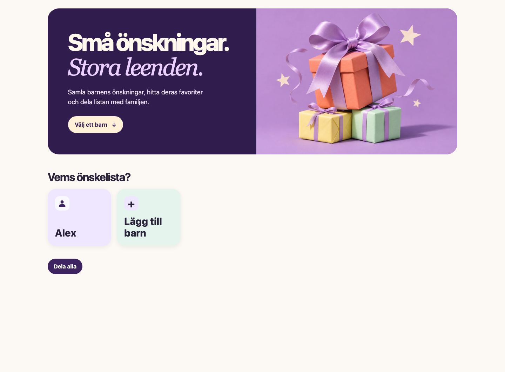

# Wishlist

Wishlist is a self-hosted app for families. Children rank gifts by choosing between two pictures. Relatives can mark gifts as bought with a shared link.

The screenshot shows the Swedish interface with sample data.

## Run with Docker Compose

Install Docker with the Compose plugin. Choose a 4 to 12 digit family PIN. In your terminal, run `export FAMILY_PIN=123456`, using your own PIN. From the project directory, run `make start`. Set the same PIN when you start the app in a new terminal. Open http://127.0.0.1:8080 on the Docker host.

The app uses the Compose volume `wishlist_data` for its SQLite database. This database stores wishlists, images, rankings, and purchase marks. Run `make stop` to stop the app. Run `make start` to start it again with the same data.

Docker publishes the app on the host's loopback address. For a deployment behind a reverse proxy on the same host, forward requests to `127.0.0.1:8080`. Set `BASE_URL` to the public HTTPS origin to generate share links for that domain, for example `BASE_URL=https://wishlist.example.org make start`. Set `PORT` to change the host port.

Enter the family PIN once in each browser to unlock the app for one year. Changing the PIN locks previously unlocked browsers. A shared link shows the full wishlist and lets visitors mark or unmark gifts as bought. Purchase marks appear in the shared view.

## Share wishlists

Use the family share button on the home page to find the family link. The same link remains valid when you add children or change the visible lists.

For each list you want to include, select its family sharing checkbox. The app saves changes immediately when you select or clear the checkbox. New and existing lists stay hidden until you select this setting. The shared family page shows only children with visible lists. Visitors can switch children and choose between their visible lists. If a child has one visible list, it opens directly.

Use the share button in a wishlist to share that list separately. That link gives access to that list only, even when the list is hidden from the family page. Existing list links continue to work. Both shared views show the child's name and the list title.

Visitors with a shared link do not need the family PIN. They can mark or unmark wishes as bought. Purchase marks are shared between the family view and the separate list view. Hiding a list removes access through the family link, including its images and purchase controls.

## Develop and test

Use Go 1.27.4. Run `go run ./cmd/wishlist` to start the app. Set `LISTEN_ADDR` to change the default address `:8080`. Set `DATABASE_PATH` to change the default SQLite file `wishlists.db`. Set `FAMILY_PIN` to your 4 to 12 digit PIN before starting the app.

Run `make test` for the Go and JavaScript tests. To run only the Go tests, use `go test ./...`. Each Godog scenario uses a fresh in-memory SQLite database. See the [acceptance scenarios](features/). The PIN scenarios remain tagged `@wip` and are excluded. The PIN feature has separate Go tests.

To debug comparisons, run `RANKING_DEBUG=1 make start` and reload the app if it is already open. On macOS, press Option–Command–J in Chrome to open the console. Each pick shows both wishes and their ranks before and after the pick. Run `make start` to turn off the trace.

## PostgreSQL and releases

Set `DATABASE_URL` to use PostgreSQL. Without this variable, the app uses SQLite. At startup, Goose applies pending database migrations for PostgreSQL and SQLite. The app does not move existing SQLite data to PostgreSQL automatically.

GitHub Actions runs tests and builds the container for pull requests. After successful checks on `main`, it publishes a release based on Conventional Commits. The first release is `0.0.1`. It also publishes the `main` image tag and a tag for the current commit. See the [build and PostgreSQL guide](docs/deployment.md) (in Swedish).

Server configuration: [Compose, PIN and PostgreSQL setup](docs/server-setup.md) (in Swedish).
